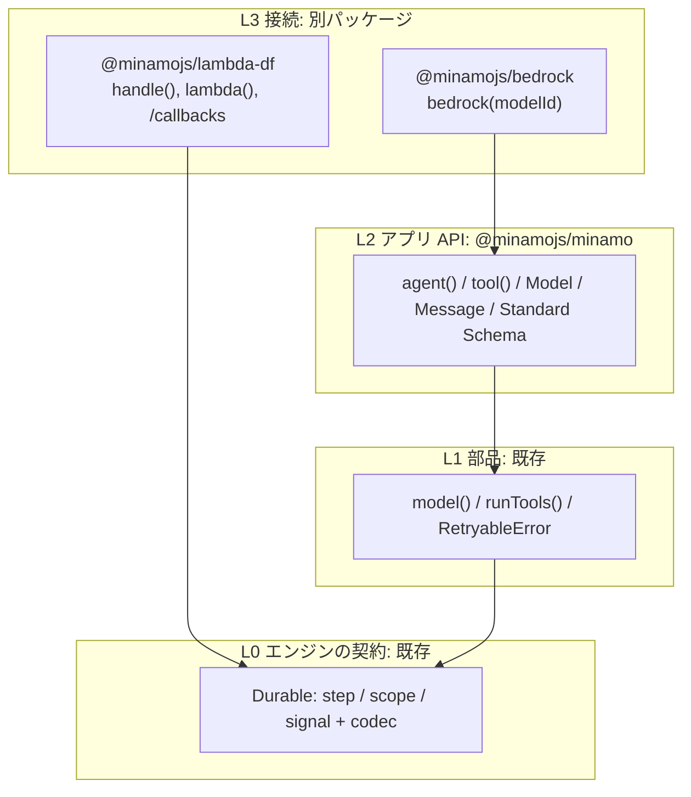

# minamo エージェント API の設計（提案）

最終更新: 2026-10-20。状態: `0.1.0-alpha.2` 向けに実装済み（9 章の alpha.2 と alpha.3 をまとめて実装し、デプロイした Lambda で確かめた。12 章）。`docs/design.ja.md` の 1 章、2 章、3 章 6 番を改めます。GPT-6.1-Sol のレビューを反映しています（11 章）。

## 0. 結論

- **書く量が多い原因**は、minamo が「ループ、メッセージ形式、プロバイダーとの変換、HITL の受け口」を持たないことです。
  - `examples/lambda-bedrock/src/handler.ts`（132 行）のうち、業務のコードは 30 行ほどです。
  - 残りの約 80 行は、どの Bedrock 利用者も同じものを書き写すコードです。
- **構成**:
  - 今の `Durable`、`model()`、`runTools()` はそのまま L0/L1 として残します。
  - その上に `agent()`、`tool()`、`Model` の契約を L2 として載せます。
  - プロバイダーと Lambda との接続は、別パッケージの L3 に置きます。Hono の `new Hono()` と `hono/aws-lambda` の `handle()` と同じ分け方です。
  - minamo は「durable の部品集」から「durable を前提にした小さなエージェントランナー」に変わります。プロバイダーのパッケージは入出力のアダプターです。Strands のループ全体を包むようなフレームワークのアダプターとは別物として扱います。
- **HITL**:
  - 実行前の承認はツールの宣言（`approval`）で書きます。
  - 途中で人に尋ねるときは、ワークフローの中で `ask()` を使います。
  - どちらもツールのスコープの中の `signal` になり、待っている間は計算資源を使いません。
  - 回答を送る側は `callbacks()` を用意します。`requestId` を渡すだけで、実行の記録からトークンを探して答えます。保留中の承認を保存する DB は要りません（5.2）。
- **規模と検証**:
  - 同じ例は 132 行から約 30 行になります（2 章）。
  - 試作（約 180 行）で、型推論、承認、却下、リプレイを `MemoryEngine` と `LocalDurableTestRunner` の両方で確かめました（8 章）。
- **評価の軸**: 行数だけでなく、「業務のコードにリプレイの都合が漏れないこと」を主な指標にします（11 章のレビューの提案）。

## 1. 現状

| コード | 行数 | 中身 |
| --- | --- | --- |
| `minamo/examples/lambda-bedrock/src/handler.ts` | 132 | toolSpecs 22、converse 11、assemble 18、toolResultMessage 12、ループ 19、ツール 23、その他 |
| `strands-lambda-durable-ts/examples/chat/backend/src/worker-minamo.ts` | 251 | 上の内容に加えて、入力の検証 12、ライブイベント 38、ハンドラー 45 |
| `strands-lambda-durable-ts/examples/chat/backend/src/worker.ts`（Strands） | 144 | `DurableModel`、`DurableTool`、`DurableToolExecutor`、`invokeDurably` を手で配線する |
| `strands-lambda-durable-functions` README のクイックスタート | 37 | `context` を 4 か所に渡す。`retryStrategy: null` を忘れられない |
| Pydantic AI harness のクイックスタート | 約 15 | `capabilities=[AWSLambdaDurability()]` と `@durable_agent_handler` だけ |

利用者が毎回書いているもの（同じループが `handler.ts`、`test/agent.ts`、`test/readme-example.ts` の 3 か所にあります）:

1. ツールの JSON Schema。
   - 実装と別に書くので二重管理になり、入力は検証されません（`call.input as never`）。
   - `Tool<I = never>` は `Record<string, Tool>` に入れると入力の型が消えます。
2. プロバイダーとの変換。stream の呼び出し、イベントからメッセージへの組み立て、ツールの結果からメッセージへの変換です。
3. ループと、ステップの名前（`model-${turn}`、`tools-${turn}`）。
4. HITL。
   - `workflow` に書き換え、`signal` の答えの型を手で書き、`approved === true` を手で確かめ、トークンを渡す先を書きます。
   - 承認を送る側（`SendDurableExecutionCallbackSuccess`、保留中の承認の保存、認可）はすべてライブラリの外です。
5. ハンドラー。`withDurableExecution` と `lambda(context)` と入力の形を毎回書きます。
6. 落とし穴。
   - `new BedrockRuntimeClient({ maxAttempts: 1 })`。
   - 記録の大きさの上限。
   - シグナルのタイムアウトと `ExecutionTimeout` の関係。

## 2. 目標のコード

```ts
import { agent, tool } from "@minamojs/minamo";
import { bedrock } from "@minamojs/bedrock";
import { handle } from "@minamojs/lambda-df";
import { z } from "zod";

const support = agent({
  name: "support",
  model: bedrock("us.anthropic.claude-haiku-4-5-20251001-v1:0"),
  instructions: "You are a customer support agent for an online shop.",
  tools: {
    get_weather: tool({
      description: "Weather forecast for a city, used to plan a redelivery.",
      input: z.object({ city: z.string() }),
      run: async ({ city }) => weather.forecast(city), // RetryableError を投げれば再試行
    }),
    issue_refund: tool({
      description: "Refunds an order after a human approves it.",
      input: z.object({ orderId: z.string(), amountYen: z.number().positive() }),
      approval: { when: ({ amountYen }) => amountYen >= 10_000, timeout: { hours: 1 } },
      run: async (input, { idempotencyKey }) => payments.refund({ ...input, idempotencyKey }),
    }),
  },
});

export const handler = handle(support, {
  prompt: (event: { prompt: string }) => event.prompt,
  onHumanRequest: request => slack.notify(request.summary), // requestId と表示用の情報だけ。DB に保存しない
});
```

目標の数値:

- `examples/lambda-bedrock` のハンドラーを 35 行以下にします。チャットの例の worker は 100 行以下にします。
- 利用者は、ステップの名前、JSON Schema、メッセージの変換を書きません。
- 承認は 1 行で宣言できるようにします。
- `Durable` を直接使う書き方は、これまでどおり使えるようにします（逃げ道）。
- アプリに固有のコードは利用者に残します。認証、承認者の決め方、デプロイがそれにあたります。行数を評価するときは、ライブラリが消したものと、残すのが正しいものを分けて数えます。

## 3. 原則の見直し

| 今の原則（`design.ja.md`） | 提案 |
| --- | --- |
| 1 章: フレームワークのアダプターは作らない。ループは利用者が 15 行で書く | ループはコアに入れる。プロバイダーのパッケージは入出力のアダプターとして作る（当面は Bedrock だけ）。Strands などのループを包むアダプターは、引き続き作らない |
| 「メッセージ形式を持たない」 | 最小の正規化メッセージをコアに入れる（`text`、`tool_call`、`tool_result`）。すべてのプロバイダーで情報を失わずに保存できるとは約束しない。対応しない機能（reasoning、画像など）は明記する |
| 3 章 6 番: HITL は `workflow` ツールの中の `signal` で書く | ツールの `approval` 宣言と、ワークフローの `ask()` で書く。どちらも `signal` に変換する |
| コアは依存ゼロ、Web 標準だけ | 維持する。Standard Schema の型は、仕様どおりそのままコピーして持つ |
| 名前と開始順で同一性を決める | 維持する。名前はライブラリが付ける。run の同一性は `key` で決める |
| 業務エラーとインフラのリトライを分ける。exactly-once は約束しない | 維持する。`onHumanRequest` と `onEvent` も at-least-once であると明記する |
| 新規 | ステップの外で動く利用者の関数は、純粋かつ決定的でなければならない。対象は schema の検証と変換、`approval.when`、`approval.request`、`output` の検証 |

## 4. レイヤー構成



| Hono | minamo |
| --- | --- |
| `new Hono()` と `app.get()` | `agent()` と `tool()` |
| `@hono/zod-validator` | Standard Schema と Standard JSON Schema。zod 4.2 以降と ArkType はそのまま渡せる。Valibot は `toStandardJsonSchema()` を通す |
| `hono/aws-lambda` の `handle(app)` | `@minamojs/lambda-df` の `handle(agent)` |
| `app.request()` | `@minamojs/minamo/testing`（`fakeModel`、`MemoryEngine.pending()`） |
| `Request`/`Response` | `Durable` |

## 5. API

### 5.1 `tool()`

```ts
tool({
  description: string,
  input: Schema<In, Out>,                // Standard Schema（検証）と Standard JSON Schema（モデルに渡す schema）
  approval?: true | { when?(input: Out): boolean; timeout?: Duration; request?(input: Out): unknown },
  retry?: Retry,                         // 既定: RetryableError だけを 3 回まで
  run(input: Out, ctx: { idempotencyKey, call, attempt }): O | Promise<O>,  // 1 ステップ
})
tool({ description, input, approval?, workflow(input: Out, ctx: { durable, ask, idempotencyKey, call }): Promise<O> })
```

- **schema の型**: `In` はモデルが作る値、`Out` は検証した後に `run` と `when` が受け取る値です。
- **JSON Schema**: `schema["~standard"].jsonSchema.input({ target: "draft-07" })` で作ります。片方の仕様しか持たない schema のために、検証器と JSON Schema を別々に渡せる口も用意します。
- **検証の失敗**: エラーの結果としてモデルに返し、モデルが引数を直して呼び直せるようにします。
- **検証はステップの外**で行います。そのため、schema の refine や transform は純粋でなければなりません。時刻、乱数、外部 DB を使う検証は `workflow` の中で `durable.step` を使って書きます。
- **実行のされ方**: ツールの呼び出しごとのスコープ `tools-<turn>:<callId>` の中で、`approval` があれば人への依頼のスコープ `$human:approval` を開き（5.2）、その後に `step("run")` を実行します。`ask(name)` は `$human:<name>` を開きます。`$` で始まる名前は利用者が使えないようにします。1 つのツール呼び出しの中で同じ `ask` の名前を 2 回使うとエラーにします（どの依頼への答えかが曖昧になるため）。
- **同一性のキー**: どれも、部品ごとに `encodeURIComponent` してから `/` でつなぎます。区切り文字が部品の中に出てきても曖昧になりません。
  - 冪等性キー: `executionId / runKey / turn / callId`。今の `<executionId>#<callId>` では、同じ実行の別の run で同じ call ID が来たときに衝突します。
  - `requestId`（5.2）: `executionId / runKey / turn / callId / 依頼の名前`。別の実行で同じ call ID が来ても衝突しません（`fakeModel` などは毎回同じ ID を使えます）。
  - 履歴の `writeId`（5.9）: `executionId / runKey`。
  - `runKey` は、1 つの実行の中で一意でなければなりません（入れ子のスコープをまたいでも一意）。同じ invocation の中で重複を見つけたら、ライブラリはエラーにします。

### 5.2 HITL

```ts
type HumanRequest = {                 // 秘密。サーバーの中だけで扱う
  requestId: string;                  // 実行をまたいで一意な ID（5.1 の同一性のキー）。通知の重複を除くキー
  token: string;                      // コールバックのトークン。持っている人が誰でも答えられる
  kind: "approval" | "input";
  executionId: string; runKey: string; agent: string; tool: string; callId: string;
  input: unknown; request: unknown; expiresAt?: string;
  summary: HumanRequestSummary;       // 公開してよい部分: requestId、kind、tool、request、expiresAt
};
type Hooks = {
  onHumanRequest?: (request: HumanRequest) => Promise<void>; // signal の publish。at-least-once
  onEvent?: (event: AgentEvent) => void | Promise<void>;     // ライブ配信用の暫定のイベント。at-least-once
};
```

- **承認の答え**は `{ approved: boolean; reason?: string }` です。承認になるのは `approved` が真偽値の `true` のときだけです（`"true"`、`"yes"`、項目がない場合は却下）。
- **結果は 4 種類に分け**、それぞれ別の文言でモデルに返します。どれの場合もツールは実行しません。
  - `denied`（人が却下した）
  - `expired`（SDK の `CallbackTimeoutError`）
  - `invalid-answer`（答えが schema に合わない）
  - `failed`（通知の失敗、または `SendDurableExecutionCallbackFailure`）。人による却下と混ぜないようにします。
- **`ask()` の答えが不正だった場合**: コールバックはもう使われているので、同じトークンでは答え直せません。ツールのエラーで終わります。
- **配送の保証**: `onHumanRequest` は 1 回だけを目指しますが、通知が成功した後、記録される前にクラッシュすると、もう一度実行されます。受け取る側は `requestId` で重複を除きます。
- **トークンの渡し先**:
  - ツールごとではなく、run（またはハンドラー）で 1 つ指定します。
  - 承認を使うツールがあるのに `onHumanRequest` がないときは、最初のモデル呼び出しより前にエラーにします。
  - 保留中の承認は、既定ではアプリの DB に保存しません。durable の実行そのものが「承認待ち」の状態を持っているので、それを読みます（次の「保留中の承認」）。
- **送る側**は 5.8 で扱います。どこまでをライブラリに入れるかと、それによって依存がどれだけ増えるかを整理しています。
- **保留中の承認**: 既定では、アプリの DB に保存しません。承認（`approval`）も任意の入力（`ask`）も、同じ仕組みで扱います。
  - **worker 側**: 人への依頼ごとに、minamo が持つスコープ `$human:<name>` を開きます。その中で、次の 2 つを順に実行します。
    - `step("request")`: 依頼の記録を残します。中身はバージョン付きの小さな封筒 `{ v: 1, requestId, kind, summary }` で、`summary` は表示用の小さな情報に限ります。
    - `signal("wait")`: 答えを待ちます。
    - SDK の `waitForCallback` が中で作る子の名前や数には頼りません。minamo が持つのは `$human:<name>` のスコープまでです。
  - **答える側**: `@minamojs/lambda-df/callbacks` が `GetDurableExecutionHistory` を読みます。`requestId` には実行の ARN が入っているので、どの実行を読めばよいかが分かります。
    - `pending(executionArn)`: まだ答えられる依頼の一覧（`requestId` と `summary`）を返します。会話の画面は、もともと会話ごとに実行の ARN を持っているので、再読み込みしても承認待ちを出せます。
    - `approve(requestId, { reason? })`、`reject(requestId, reason)`、`answer(requestId, value)`: その依頼のまだ終わっていないコールバックを 1 つだけ特定し、CallbackId で `SendDurableExecutionCallbackSuccess` を呼びます。
    - トークンはアプリのサーバーの外に出ず、アプリの DB にも保存しません。ただし、AWS のコールバックの記録には残ります（5.10）。
  - **記録から依頼を特定する決まり**（推測で近いものを探すことはしない）:
    1. `requestId` を分解し、実行の ARN、runKey、turn、callId、依頼の名前を取り出します。
    2. 記録を `NextMarker` がなくなるまで全ページ読み、操作の `Id` ごとに `Name`、`ParentId`、状態をまとめます。`EventId` はイベントの連番で、操作の識別には使いません。同じ `Id` の開始と終了のイベントは、1 つの操作の状態の変化として扱います。
    3. `Name` と `ParentId` をたどって、run のスコープ（runKey）、その下の `tools-<turn>:<callId>`、その下の `$human:<name>` を、それぞれ 1 つだけ特定します。
    4. `$human:<name>` の下にある成功した `request` のステップを読み、封筒の `requestId` が一致することを確かめます。失敗した試行は数えません。
    5. `$human:<name>` の子孫にある `CallbackStarted` を探します。同じ `Id` に `CallbackSucceeded`、`CallbackFailed`、`CallbackTimedOut` があれば、もう終わっています。実行そのものが終わっていれば、答えられる依頼として扱いません。
    6. 該当するコールバックが 1 つでなければ、何も送らずにエラーにします。記録が欠けている、`Truncated` が真である、といった場合も、空の一覧として返さずにエラーにします。
  - **最終的な判定は送信の結果**です。記録を読み終えた直後に、別の人の回答や期限切れが起こることは止められないので、`SendDurableExecutionCallbackSuccess` の結果で決めます。
    - 先に受け付けられた回答だけが有効です。
    - `CallbackTimeoutException` は「期限切れ」と「すでに答え済み」を区別しないので、`closed` という 1 つの型にまとめます。
    - 応答を受け取る前に通信が切れた場合は、「受け付けられたかどうか分からない」として返します。
    - アクセスの拒否、スロットリング、サービスの障害は、409 にしません。
  - **読み方と権限**:
    - `summary` はステップの結果（payload）に入っているので、`pending` は `IncludeExecutionData: true` で読みます。この場合、同じ実行のモデルの応答やツールの入出力も API のサーバーに届きます。
    - `pending` は必要な `summary` だけを返し、生のイベント、CallbackId、他の payload を画面や通常のログに出しません。
    - 回答のときに payload なしで読む最適化は、実機で CallbackId などが残ることを確かめてから考えます（推測）。
    - 認可は 2 段です。記録を読む前に、その実行がこのアプリ・この利用者のものかを確かめます。答える前に、その人がその依頼に答えてよいかを確かめます。`requestId` は秘密ではなく、権限の証明にもなりません。
    - IAM: 答える側に `lambda:GetDurableExecutionHistory` と `lambda:SendDurableExecutionCallbackSuccess` が要ります。リソースは対象の関数に絞ります。この方式では、API が実行の記録を読める範囲が以前より広がります。
  - **呼び出し回数の目安**: `GetDurableExecutionHistory` は、アカウントとリージョンで毎秒 15 回までです。
    - 1 回の `pending` は全ページを読むので、ページ数を P とすると P 回の呼び出しになります。N 個の画面が T 秒ごとに読むと、およそ N × P / T 回／秒です。例えば、1 ページの実行を 3 秒ごとに読む画面が 45 個あれば、それだけで上限に達します（計算の例で、測ってはいません）。回答のときの読み込みと、SDK のリトライも同じ上限を使います。
    - そのため、使い方は次のようにします。
      - 新しい依頼は `onHumanRequest` で通知します（push）。
      - `pending` は、画面を最初に開いたとき、再読み込みしたとき、利用者が更新を押したときだけ呼びます。今のチャットの例の 3 秒ごとのポーリングに、そのまま足すことはしません。
      - スロットリングされたら、`retryAfterSeconds` に従って待ちます。
    - `ListDurableExecutionsByFunction` は状態（RUNNING など）、名前、開始時刻でしか絞り込めず、「承認待ちの実行」だけを取り出せません。そのため、多くの会話をまたいだ承認者の受信箱には向きません。そのときだけ、アプリが `onHumanRequest` で `requestId` と `summary` を保存します。トークンは保存しなくてよく、答えるときは同じ `approve(requestId)` を使います（回答のときの記録の読み込みは残ります）。
  - **互換性**: 封筒のバージョンと、対応する SDK の世代ごとの記録の例（テスト用の fixture）を持ちます。知らない形の記録には、エラーで応えます。
  - **実機での確認（2026-10-20）**: デプロイした Lambda（us-east-1、`minamo-example`）の記録で、上の決まりどおりに依頼を 1 つだけ特定し、`pending`、`approve`、`reject`、答えた後の `closed`、終わった実行での空の一覧を確かめました（12 章）。`LocalDurableTestRunner` が作った記録も、テストの fixture として使っています（`test/callbacks.test.ts`）。
- **未対応として明記する機能**（基礎の API に、意味の曖昧な項目だけを先に足すことはしません）:
  - 承認するときに引数を書き換える機能。入れる場合は、書き換えた引数を検証し直して記録します。
  - まとめて承認する UI。
  - run の取り消し。却下とは別の契約になります。
- **他との比較**:
  - Pydantic AI は、遅延ツールのリクエストと結果、そして `HandleDeferredToolCalls` で解決する仕組みを持ちます。Lambda の harness は、制御フローの例外を値として記録します。承認の UI や、Lambda のコールバックで待つ仕組みは付いていません。
  - Strands のアダプターは `invokeDurably` が再開のループを持ち、ツールの本体にもう一度入り直します。
  - minamo は、ツールのスコープの中で `signal` で待ち、通知と回答のヘルパーまでを標準の道にします。

### 5.3 `agent()` と `run()`

```ts
const a = agent({ name, model, instructions?, tools?, output?: Schema<O>, maxTurns? = 10 });
const result = await a.run(durable, { key, prompt, history? | conversation?: { id, store } }, hooks?);
// result: { output: O; messages: Message[]; newMessages: Message[]; turns: number; finish: { reason; usage? }; historyUpTo?: number }
```

- **`key` は必須**です。`handle(agent)` を使う場合は、アダプターが `agent.name` を渡すので書かなくて済みます。
  - run は `scope(key)` を開きます。中のオペレーションは `model-<turn>` と `tools-<turn>:<callId>` です。
  - key には、時刻、乱数、完了順のカウンターを使ってはいけません。
- **run のスコープが記録する結果**は `{ output, newMessages, turns, finish, historyUpTo? }` だけです。履歴をチェックポイントに二重に記録しないためです（5.10）。
  - `messages`（履歴を含む全体）は、スコープの外で作ります。`history` を渡した場合は `history` と `newMessages` をつなぎます。`conversation` を渡した場合は `read(id, historyUpTo)` と `newMessages` をつなぎます。
  - スコープが完了した後のリプレイでは中の処理が動かないので、履歴の位置（`historyUpTo`）はスコープの結果として返す必要があります。スコープの外で `head()` を呼び直すと、自分や後の run の追記を含んだ別の位置になります。
- **モデルのステップ**には、まとめたメッセージと `finish`（停止の理由、usage）を記録します。テキストの差分は 1 つのパーツにまとめます。
- **リトライの既定**: モデルのステップの既定のリトライは、既存の `model()` と同じ判定を共有します。試作は `model.retry` が未指定だと 1 回しか実行しない誤りがありました（11 章の 3 番）。
- **`output`**（構造化出力）: `final_result` ツールを合成します。同じ応答の中で、他のツールと混ざった場合は次のように扱います。
  - 通常のツールはすべて実行します。
  - `final_result` には「ツールの結果を見てから、次のターンで確定してください」というエラーの結果を返します。
  - `final_result` が 2 つ以上あるとき、また利用者のツール名が予約名と衝突するときは、エラーにします。
  - どの call ID にも、結果か「実行しなかった」という結果を必ず対応させます。
- **`newMessages`** は、次の run の `history` にそのまま渡せることを契約にします。終わったときにも `final_result` の成功の `tool_result` を追加します（11 章の 2 番）。
- **`history`** は変更しないスナップショットとして扱います。codec が型を保てない値（`Date`、`Map` など）は、durable な値として扱えないことを型で示します。
- **`conversation`** を渡すと、履歴の読み込みと保存をライブラリが行います（5.9）。`history` と同時には指定できません。

### 5.4 `Model` の契約とプロバイダー

```ts
interface Model {
  readonly id: string;
  retry?: Retry;                                   // 未指定なら model() の既定
  stream(request: { system?; messages: readonly Message[]; tools: readonly ToolSpec[] }): AsyncIterable<ModelEvent>;
}
type ModelEvent = { type: "text"; text } | { type: "tool_call"; id; name; input } | { type: "finish"; reason; usage? };
```

- **正規化はアダプター**が行います。ツールの入力の JSON 断片をつなぐ処理も、アダプターの中です。
- **`@minamojs/bedrock`**:
  - peer dependency は `@aws-sdk/client-bedrock-runtime` です。
  - 中身は、今の例の `converse`、`assemble`、`toolResultMessage` を移したものです。
  - SDK のクライアントのリトライは無効にしておきます。
- 他のプロバイダーには当面対応しません（2026-10-20 に決定）。`Model` は公開の契約なので、必要になれば利用者が自分で実装できます。

### 5.5 Lambda との接続（`@minamojs/lambda-df`）

```ts
export const handler = handle(support, { prompt: (event: { prompt: string }) => event.prompt, onHumanRequest, onEvent });
export const handler = handle(async (event: WorkerRequest, durable) => { ... });  // 自分で組む場合
```

`handle` は `withDurableExecution` と `lambda(context)` を包みます。今の `lambda()` はそのまま公開します。

`AgentEvent` は、今のチャットのフロントエンドが使っている区別をすべて持たせます。

- `run_started`
- `model_start`（`call`、`attempt`）
- `text`（`call`、`attempt`、`text`）
- `tool`（`status`、`result`）
- `human_requested`（`summary` だけ）
- `done`
- `failed`

それぞれに `runKey` を付けます。今の `ChatEvent` は `kind` で区別しているので、移行のときは名前をそろえるか、変換を例に書きます。

チャットの例の worker は、次のようになります。

```ts
export const handler = handle(async (req: WorkerRequest, durable) => {
  const channel = new ChatChannel(publisher, req.userId, req.conversationId, req.runId);
  const history = await loadMessages(req.conversationId, req.baseSeq);
  const result = await shop.run(durable, { key: "chat", prompt: req.text, history }, {
    onEvent: event => channel.publish(event),
    onHumanRequest: request => channel.publish({ kind: "human_requested", ...request.summary }), // ブラウザーには summary だけ
  });
  return durable.step("save-conversation", () => completeRun({ ...req, messages: result.newMessages }));
});
```

### 5.6 テスト

```ts
const engine = new MemoryEngine();
const running = engine.run(d => support.run(d, { key: "t", prompt: "refund A-1" }, { onHumanRequest: async () => {} }), undefined);
const [request] = await engine.pending();          // 答えを待っている signal
assert.equal(refunds, 0);
engine.complete(request.token, { approved: true });
assert.equal((await running).output.refunded, true);
```

`fakeModel(script)` は `@minamojs/minamo/testing` から公開します。`MemoryEngine` ではタイムアウトと、大きな結果の扱い（ReplayChildren）は確かめられません。`LocalDurableTestRunner` でのテストも合わせて行います。

### 5.7 逃げ道

`agent.run` は `Durable` を受け取る普通の関数です。`handle` に渡す関数の中で、`durable.step` と組み合わせたり、`key` を変えて複数のエージェントを順に呼んだりできます。`model()` と `runTools()` は、ループを自分で書きたい人のために残します。

### 5.8 回答を送る側と依存の範囲

HITL には 2 つの側があります。

- **待つ側**（worker）: `signal` で止まり、`requestId` と `summary` を通知します。これは 5.2 のとおり minamo が持ちます。
- **答える側**（API）: 承認者が押したボタンを受け取り、その人が答えてよいかを確かめてから、`SendDurableExecutionCallbackSuccess` を呼びます。今のチャットの例では、`api.ts` の `answerApproval` を利用者が手で書いています。中身は、本文の検証、DB に保存した保留中の承認との照合、送信、期限切れなどのエラーを 409 にすること、保留中の承認の削除です。B を入れると、DB の保留中の承認との照合と削除は要らなくなります。実行がそのアプリのものかの確認と、承認の権限の確認は残ります（5.2 の「保留中の承認」）。

答える側をどこまで minamo に入れるかには、3 つの段階があります。

| 段階 | 内容 | 増える依存 |
| --- | --- | --- |
| A. 何もしない | 利用者が AWS SDK を直接呼ぶ。答えの形（`{ approved: true }`）は利用者が守る | なし |
| B. `callbacks()` | `pending(executionArn)`、`approve(requestId, { reason? })`、`reject(requestId, reason)`、`answer(requestId, value)`。実行の記録からトークンを探して送り、答えの形を minamo の承認の契約に合わせ、SDK のエラー（期限切れ、答え済み）を型のある結果に変える | `@aws-sdk/client-lambda` を任意の peer dependency にする。`@aws/durable-execution-sdk-js` がすでに `@aws-sdk/client-lambda` に依存しているので、新しい種類の依存は増えない。ただし `/callbacks` を使う人は、`@aws-sdk/client-lambda` を自分の `package.json` に直接入れる（推移的に入っているだけでは、パッケージマネージャーによっては解決できない） |
| C. `approvalHandler()` | Web 標準の `Request` を受け取って `Response` を返す受け口。本文の解析、`authenticate`、`resolve`、`authorize` の呼び出し、B による送信、409 への変換を行う | パッケージはなし（Web 標準だけ）。ただし、認証と認可の流れという意味の契約を minamo が持つことになる |

推薦は **B を入れ、C は当面は例（Hono のルート）として示す** ことです。

- B は答えの形を定める側と送る側を一致させるためのもので、承認の契約の一部です。依存も実質的に増えません。
- C は依存は増えませんが、HTTP の形（API Gateway のイベント、Function URL、Hono）と認証の仕組みはアプリごとに違います。API Gateway のイベントを `Request` に変える処理も必要になります。例で何度も同じ形が出てくるようなら、そのときにライブラリに上げます。

パッケージごとの依存は、次のようになります。

| パッケージ | 今 | 提案後 | 利用者が新しく入れるもの |
| --- | --- | --- | --- |
| `@minamojs/minamo`（`agent`、`tool`、`/testing` を含む） | 依存ゼロ | 依存ゼロ。Standard Schema の型はコピーして持つ。zod などは利用者が選んで入れる | schema のライブラリ 1 つ（zod など）。今も入力の検証を手で書いている分の置き換え |
| `@minamojs/bedrock`（新規） | ― | peer: `@aws-sdk/client-bedrock-runtime` | なし。今の例ですでに使っている |
| `@minamojs/lambda-df` の `handle()` | peer: `@aws/durable-execution-sdk-js` | 変わらない | なし |
| `@minamojs/lambda-df/callbacks` | ― | 任意の peer: `@aws-sdk/client-lambda` | `/callbacks` を使う人は直接入れる。新しい種類の依存ではない（上の表の B を参照） |
| `@minamojs/dynamodb`（新規、任意。5.9） | ― | peer: `@aws-sdk/client-dynamodb` | 会話を DynamoDB に保存したい人だけ。会話を保存するアプリなら、たいていもう入れている |

minamo に入れないもの（入れると依存か責任が大きく広がるもの）:

- 保留中の承認の保存先。既定では保存先が要りません（5.2）。会話をまたいだ受信箱が要るアプリだけが、自分で保存します
- 認証（JWT や Cognito のライブラリが要る）
- 通知（Slack、SNS、AppSync。AppSync には SigV4 の署名ライブラリが要る）
- CDK の construct（`aws-cdk-lib` が要る）。必要になっても、IAM と `DurableConfig` の設定例をドキュメントに書くところまでにします

まとめると、必ず増える npm の依存は `@minamojs/bedrock` の peer dependency 1 つだけで、それも利用者がもともと入れているものです。`@minamojs/dynamodb` は、会話を DynamoDB に保存したい人だけが入れます。広がるのは依存ではなく、minamo が持つ契約の範囲（ループ、メッセージ形式、承認の答えの形、履歴の保存の契約）です。

### 5.9 会話の履歴

会話の履歴の保存は、3 つの段階に分けます。どの段階でも、コアの依存はゼロのままです。

| 段階 | 置き場所 | 利用者が書くこと |
| --- | --- | --- |
| 0. 受け渡しだけ | コア（5.3 の `history` と `newMessages`） | 読み込み、保存、同時実行の制御をすべて書く。Pydantic AI の `message_history` と `new_messages()` と同じ水準 |
| 1. `HistoryStore` の契約 | コア（インターフェースと、テスト用の `memoryHistory()`） | `conversation: { id, store }` を渡すだけ。リプレイで履歴が変わらないようにすること、保存の冪等性、追記の競合の検出はライブラリが持つ |
| 2. DynamoDB の実装 | `@minamojs/dynamodb`（任意の別パッケージ） | テーブルを 1 つ作り、`dynamoHistory({ client, table })` を渡す |

推薦は 1 と 2 の両方を作ることです。会話を保存しないエージェントはまれなので、「DynamoDB で頑張って」では Pydantic AI の水準にとどまります。一方で DynamoDB を使わない人は、別パッケージを入れなければ依存は増えません。

#### 契約

```ts
interface HistoryStore {
  /** 保存されている最後の run の番号。会話がなければ 0 */
  head(conversationId: string): Promise<number>;
  /**
   * 1 から upTo 番目までの run のメッセージを、すべて、同じ順序と内容で返す。
   * 欠けた履歴を正常な結果として返してはいけない（読めない部分があればエラーにする）。
   */
  read(conversationId: string, upTo: number): Promise<Message[]>;
  /**
   * seq 番目の run として追記する。すでにあれば、writeId が同じなら既存の本文を変えずに成功、違えば HistoryConflictError。
   * 同じ writeId では、いつも同じ messages を渡す。通信の失敗など結果の分からない失敗は、HistoryConflictError にしない。
   */
  append(conversationId: string, seq: number, messages: Message[], writeId: string): Promise<void>;
}
```

run のスコープ（呼び出したときに同期的に開く）の中で、次の順に動きます。

1. `step("history-head")` で `head()` を呼び、その値（数字 1 つ）だけを記録します。履歴の中身は記録しないので、チェックポイントの大きさは増えません。
2. `read(id, upTo)` はステップの外で呼びます。1 から `upTo` までは追記した後に変わらず、`read` はそれを欠けなく返す契約なので、どのリプレイでも同じ履歴になります。今のチャットの例が `baseSeq` で手作業でやっていることを、ライブラリが行います。
3. エージェントのループを回します。
4. `step("history-append")` で、`seq = upTo + 1` として `newMessages` を追記します。このステップが再実行されても、`writeId` が同じなので二重には書きません。
5. スコープの結果として `historyUpTo = upTo` を返します（5.3）。

保存先が守ること:

- 1 から `upTo` までの履歴は、それを参照する実行が動いている間は消したり書き換えたりしません。TTL で消す場合も、この期間より長くします。
- `head` と `read` は、直前に書いた内容が見える読み方をします。

- **同じ会話で 2 つの run が同時に走った場合**: 後から追記したほうが `HistoryConflictError` になります。ただし、これは履歴が二重に確定するのを防ぐだけです。
  - 追記はループが終わった後なので、負けた run のツール（返金など）は、もう実行されています。冪等性キーには実行の ID が入るので、別の実行どうしの返金は同じ操作として扱われません。
  - `HistoryConflictError` も、後で説明する `HistoryTooLargeError` も、保存の失敗も、実行済みの業務の副作用を取り消しません。
  - そのため、副作用のあるエージェントでは、run を始める前から終わるまで（承認待ちの間も含む）、1 つの会話で走る run を 1 つにする制御をアプリが持ちます。今のチャットの例と同じです。`HistoryConflictError` は、実行の前に止める仕組みではありません。
  - 失敗した run を、新しい実行として最初からやり直すと、冪等性キーが変わります。外部 API で二重に実行されないかは、アプリが確かめます。
- **履歴が長くなった場合**: 古いメッセージの要約や切り詰めは、`read` の結果に対する純粋な関数として後から足せるようにします（今回は作りません）。

#### DynamoDB の実装（`@minamojs/dynamodb`）

- **テーブル**: パーティションキーは `conversationId`（文字列）、ソートキーは `seq`（数値）です。1 つの run を 1 つのアイテムにします。
- **読み込み**: `head` は、`ConsistentRead: true` で `seq` の降順に `Limit: 1` の Query を 1 回呼びます。`read` は、`ConsistentRead: true` で `seq <= upTo` を昇順に、すべてのページを読みます。DynamoDB の Query は既定では結果整合性なので、強い整合性を指定しないと、直前の追記が見えないことがあります。
- **追記**: `attribute_not_exists` の条件付きの `PutItem` を 1 回呼びます。`ReturnValuesOnConditionCheckFailure: ALL_OLD` を指定します。
  - 条件で失敗したときは、返ってきた既存のアイテムの `writeId` を比べます。同じなら、既存のアイテムを変えずに成功とします（記録の前にクラッシュして、追記のステップがもう一度動いた場合）。違えば `HistoryConflictError` にします。
  - `attribute_not_exists OR writeId = :writeId` で上書きする形にはしません。変わらないはずの履歴を書き換えてしまうからです。
- **本文**: minamo のコーデックで文字列にして、1 つの属性に入れます。アイテムには `writeId` も入れます。そのため `@aws-sdk/lib-dynamodb` は要らず、`@aws-sdk/client-dynamodb` だけで済みます。
- **大きさの上限**: DynamoDB のアイテムは、属性の名前と値をすべて含めて 400 KB までです。
  - アダプターは、書く前に UTF-8 でアイテム全体の大きさを測り、超えていれば `HistoryTooLargeError` にします。この場合も、実行済みの副作用は取り消されません。
  - ツールが参照を返すようにすれば上限に当たりにくくなりますが、必ず保存できるとは限りません。何ターンも続く run では、合計が上限を超えることがあります。
  - S3 への退避は入れません（入れると `@aws-sdk/client-s3` も必要になります）。

#### 使わない案: 1 つの会話を 1 つの durable 実行にする

durable 実行は最長 366 日（`ExecutionTimeout` の上限 31,622,400 秒）続けられるので、会話全体を 1 つの実行にして、ユーザーの発言ごとに `signal` で待つこともできます。この形なら DB は要りません。それでも標準にしない理由は 4 つです。

- **コードの更新が届かない**: 実行は開始したときのバージョンに固定されるので、走っている会話にコードの修正が反映されません。
- **履歴が消える**: 完了した実行の履歴は、保持期間（`RetentionPeriodInDays`、最大 90 日）を過ぎると取り出せなくなります。
- **長い会話で上限に当たる**: オペレーションの数とチェックポイントの大きさの上限があります。
- **会話の一覧が作りにくい**: 一覧の表示や検索には、結局どこか別の保存先が要ります。

### 5.10 チェックポイントに置くものと外に出すもの

**チェックポイントに置くのは「この実行を決定的にリプレイするために必要な、非決定的な操作の結果」です。** 小さく、実行と保持期間の間だけ生きていれば足りるものに限ります。次のどれかに当てはまるものは外に出します。

- 実行より長く生きる必要がある。
- 実行の外から、検索したり、頻繁に読んだりする必要がある。特定の 1 つの実行の承認待ちを、ときどき読むだけなら例外です（5.2）。
- 大きい。
- 秘密である。

#### 守る上限（2026-10-20 に確認）

| 上限 | 値 | 出典 |
| --- | --- | --- |
| 1 つのオペレーションの payload（チェックポイントとコールバック） | 1 MB | Lambda のクォータ |
| 1 つの実行で書き込む量の合計 | 100 MB（引き上げ不可） | Lambda のクォータ |
| 1 つの実行のオペレーション数 | 30,000（引き上げ不可。step の試行もそれぞれ 1 つと数える） | Lambda のクォータ、2026-10-13 の発表 |
| 子コンテキストの結果が ReplayChildren に切り替わる大きさ | 256 KiB | SDK 2.4.0 と 2.7.1 のソース |
| `@minamojs/lambda-df` が step の結果を失敗させる大きさ | 1,000,000 バイト（1 MB が 10^6 か 2^20 かが公開されていないので、小さいほうにした） | `packages/lambda-df/src/index.ts` |
| 完了した実行の履歴の保持期間 | 1〜90 日（既定は 14 日） | `DurableConfig.RetentionPeriodInDays` |
| `GetDurableExecutionHistory` の呼び出し回数 | 毎秒 15 回 | Lambda のクォータ。頻繁な読み込みや、多くの実行をまたいだ一覧には使えない（5.2） |
| 実行の入力（非同期の呼び出し） | 1 MB | Lambda のクォータ |

#### データごとの置き場所

| データ | 置き場所 | 理由と注意 |
| --- | --- | --- |
| 実行の入力 | チェックポイント（実行の入力） | `conversationId` と発言などの ID と短い値だけにする。履歴は入力に入れない |
| モデルの応答（まとめたメッセージ、`finish`、usage） | チェックポイント（`model-<turn>`） | これがないと、リプレイでモデルをもう一度呼ぶことになる。テキストの差分は記録しない |
| ツールの結果 | チェックポイント（`run`） | 数十 KB 以内を目安にする。大きな結果（ファイル、検索結果の全文など）は S3 などに置き、キーを返す |
| run の結果 | チェックポイント（run のスコープ） | `output`、`newMessages`、`turns`、`finish`、`historyUpTo` だけにする（5.3）。履歴を含めない |
| 履歴の位置（`head` の値） | チェックポイント（`history-head`） | 数字 1 つ |
| 会話の履歴の本体 | 外（`HistoryStore`） | 実行が終わった後も、別の実行や画面から読むため。保持期間と 100 MB の上限もある |
| 人への依頼（承認と `ask`） | チェックポイント（`$human:<name>` の中の `request` のステップに公開してよい要約、コールバックの記録に CallbackId） | 既定では外に出さない。答える側は `callbacks()` で実行の記録から読む（5.2）。会話をまたいだ受信箱が要るときだけ、`requestId` と要約を外に保存する（トークンは保存しない） |
| 承認の答え | チェックポイント（コールバックの結果） | 小さい。`{ approved, reason }` |
| 承認した人の記録（監査） | 外 | 保持期間を過ぎても要る。承認者の身元は、送る側の認証の結果からとる |
| ライブ配信のイベント（テキストの差分など） | どちらにも置かない（配信の経路だけ） | 暫定のもの。リプレイでは送らない |
| 画像や PDF などのバイナリ | 外（S3 など）。メッセージには参照だけを置く | 最初の版のメッセージ形式はバイナリを持たない（3 章） |
| 秘密の値（API キー、トークン、個人情報） | ライブラリは、秘密の設定と `HumanRequest` 全体をステップの結果として記録せず、公開のイベントにトークンを出さない。それ以上は保証しない | サービスの記録には、コールバックの CallbackId（トークン）が残る。`GetDurableExecutionHistory` の `CallbackStartedDetails` から読める（`examples/lambda-bedrock/scripts/smoke.mjs` はこれで答えている）。プロンプト、モデルの応答、ツールの入力に個人情報が入れば、それも記録される。履歴を読める IAM の権限は、秘密への権限として管理する。マスキングや暗号化（KMS のカスタマー管理キー）はアプリが決める |
| usage の集計 | 各モデルのステップに記録。集計は外（CloudWatch など） | 実行をまたいだ集計は、チェックポイントではできない |

#### 外に出すときの決まり: 参照をチェックポイントに、本体は変わらない外に置く

外のデータをステップの外で読むと、リプレイのたびに読み直します。リプレイで同じ結果になるのは、読む先が変わらないときだけです。

- **追記だけの保存先**: 番号をチェックポイントに置き、本体はその番号までを読みます（`HistoryStore` の `head` と `read`。5.9）。
- **内容で決まるキー**: S3 のキーにハッシュを含め、チェックポイントにはキーとハッシュを置きます。読んだときにハッシュを確かめれば、書き換えも検出できます。`strands-lambda-durable-functions` の `createOffloadSerdes` が同じ形です。
- **変わりうる外のデータ**（在庫、残高など）は、ステップの中で読み、結果をチェックポイントに残します。

#### ライブラリが守ること

- run のスコープの結果に履歴を含めません（5.3）。
- `HumanRequest` 全体をステップの結果として返しません。`publish` の中で渡すだけにします。ただし、コールバックの記録にトークンが残ることは止められません（上の表）。
- `@minamojs/lambda-df` の step の上限を 1 MB に直し、超えたときは何を外に出すべきかが分かるエラーにします。
- 子コンテキストが ReplayChildren に切り替わることは止めません。結果は正しく、リプレイのときに子の処理をたどり直す分だけ遅くなります。長い run の `newMessages` がこれに当たることは、ドキュメントに書きます。
- 大きな値を自動で外に出す仕組み（オフロード）は、alpha.2 と alpha.3 では作りません。作るときは、エンジンの境界の serdes として作ります。依存を増やさない選択肢として、SDK の `FileSystemSerdes`（EFS や S3 Files のマウントに書き出す）を先に調べます。

## 6. オペレーションの木と上限

試作を `LocalDurableTestRunner`（SDK 2.4.0）で動かしたときの木です。

```
/support                 CONTEXT (run)
support/model-1          STEP
support/tools-1:a        CONTEXT
support/tools-1:c        CONTEXT
tools-1:a/run            STEP
tools-1:c/approval       CONTEXT (waitForCallback)
approval/(callback)      CALLBACK
approval/(submitter)     STEP
tools-1:c/run            STEP
support/model-2          STEP
```

`conversation` を渡した場合は、run のスコープの中で `support/history-head`（STEP、最初）と `support/history-append`（STEP、最後）が加わります。スコープの結果には `historyUpTo` が入ります。スコープが完了した後のリプレイでは、`read(id, historyUpTo)` をもう一度呼んで `messages` を作ります。

- **オペレーションの数**は、およそ「run 1 + モデル呼び出しの数 + 2 × ツールの数 + 5 × 人への依頼の数（`$human:<name>` のスコープ 1、`request` のステップ 1、待つための 3）（+ 履歴を使うなら 2）」です。人への依頼は、`approval` と `ask` の両方を数えます。
  - リトライの試行と、ワークフローの中の操作は、これとは別に加わります。
  - `maxTurns` は、1 ターンのツールの数を制限しません。
- **上限**: AWS は 2026-10-13 に、1 実行のオペレーションの上限を 3,000 から 30,000 に、チェックポイントの上限を 256 KB から 1 MB に引き上げました（[発表](https://aws.amazon.com/about-aws/whats-new/2026/10/aws-lambda-durable-gen-limit-increase/)）。
  - 今の `@minamojs/lambda-df` は、独自に 256 KiB で失敗させています。これは古くなっているので、別に直す必要があります。
  - SDK は、子コンテキスト（minamo の `scope`）の結果が 256 KiB を超えると ReplayChildren に切り替えます。その場合は結果を記録せず、リプレイのたびに子の処理をもう一度たどって結果を作り直します。この 256 KiB の値は、SDK 2.4.0 と最新の 2.7.1 のソース（`CHECKPOINT_SIZE_LIMIT_BYTES`）で確かめました。サービスの上限が 1 MB に上がった後も変わっていません。
  - 何をチェックポイントに置き、何を外に出すかは 5.10 で整理しています。
- **互換性**: 今の例と比べると `support/` の階層が増えるので、実行中の実行とは互換性がありません。公開したバージョンに固定し、新しい実行だけを切り替えます。

## 7. 制約とリスク

- **決定性**: ツールの集合、純粋でない検証、`approval.when` の結果が変わると、オペレーションの並びが変わります。3 章の新しい原則をドキュメントに書きます。
- **タイムアウト**:
  - `ExecutionTimeout` は実行全体の時間です。`approval.timeout < ExecutionTimeout` を静的に確かめるだけでは足りません。遅いターンで承認を始めると、残り時間のほうが短いことがあります。
  - 設定の例をドキュメントに書くときに、`approval.timeout` と `ExecutionTimeout` の関係も注意として書きます。
- **トークン**: 5.2 のとおり、トークンはサーバーの外に出しません。既定ではアプリが保存することもありません。
- **コアの大きさ**: 見積もりはまだ測っていません（推測）。大きさを守るために標準の道をサブパスに追い出すことはしません。

## 8. 試作で確かめたこと（2026-10-20、`/tmp/minamo-proto`、捨てるコード）

- **構成**: 今のコア（`index.ts`、`memory.ts`）と `lambda-df` をそのまま使い、その上に `agent.ts`（約 180 行）を置きました。依存は zod 4.6.7、TypeScript 5.9.3、`@aws/durable-execution-sdk-js` 2.4.0、`-testing` 1.1.4 です。
- **型（`tsc --strict`）**:
  - `run` の引数は schema から推論されます。`({ cty })` はエラー TS2339 になりました。
  - `approval.when` の引数も推論されます。`n.toUpperCase()`（`n` は number）はエラーになりました。
  - `result.output` は `{ reply: string; refunded: boolean }` と推論されました。
- **`MemoryEngine`**:
  - `{ approved: true }` を返した場合: 2 回の invocation で完了し、返金は 1 回でした。モデル呼び出しは 2 回で、再開しても繰り返されませんでした。
  - `{ approved: "true" }` を返した場合: 却下になり、`run` のステップは記録されませんでした。モデルは `refunded: false` を返しました。
- **`LocalDurableTestRunner`**:
  - 状態は `SUCCEEDED` で、結果は `done: [true,true]` でした。
  - モデル呼び出しは 2 回、返金は 1 回、通知は 1 回でした。
  - スコープは呼び出し順に開きました（6 章の木）。
- **試作に残っている誤り**（11 章で指摘されたもの。本実装で直します）:
  - `final_result` が他のツールを捨てる。
  - 履歴に `tool_result` がない。
  - モデルの既定のリトライがない。
  - タイムアウトを `expired` にしていない。
  - `key` がない。
- **確かめていないこと**: Bedrock のアダプター、タイムアウトの経路、ReplayChildren、デプロイした Lambda での動作。

## 9. ロードマップ

1. **alpha.2（L2 の最小限）**
   - `tool()`、`agent()`（`key`、`finish`、`output` の終わり方を含む）、`Model`、`Message`、`approval`、`ask`、`fakeModel`、`MemoryEngine.pending()`、`HistoryStore` と `memoryHistory()`、`@minamojs/bedrock`、`handle()` を作ります。
   - `examples/lambda-bedrock` を書き直します。
   - `MemoryEngine` と `LocalDurableTestRunner` の両方で、木、承認、却下、期限切れ、混ざった `final_result` をテストします。
2. **alpha.3（HITL の送る側とチャット）**
   - `callbacks()`（`pending` を含む）、`AgentEvent` とテキストをまとめる処理、`@minamojs/dynamodb` を作ります。`approvalHandler()` に相当するものは、チャットの例の Hono のルートとして書きます。
   - チャットの例を、保留中の承認を DB に保存しない形に移します。
     - `setPendingApproval`、`clearPendingApproval` を消します。
     - `api.ts` の、`conversation.pendingApproval` と `waiting_approval` を回答の条件にしている部分を、`callbacks()` に置き換えます。
     - フロントエンド（`ChatView.tsx`）の、承認待ちが 1 件である前提と、承認待ちのときのポーリングを、実行中の実行の `pending` 一覧から表示する形に変えます。複数の `requestId`、答え済みや期限切れの `closed`、「一覧が読めない」と「本当に 0 件」の区別を扱います。
     - 会話の状態（実行中かどうか）と、コールバックの承認待ちの状態は、役割を分けます。
   - `lambda-df` の上限を 1 MB に合わせます。オフロードは、必要と分かった時点で別に検討します（5.10）。
3. **その後**: `agent.asTool()`（サブエージェント）、MCP のツール、承認するときの引数の書き換え、Cloudflare のアダプターです。

## 10. 決定事項（2026-10-20）

1. **L2 の置き場所**: `agent()` と `tool()` は、メインのエントリー `@minamojs/minamo` から公開します。
2. **プロバイダー**: 当面は Bedrock だけにします。
3. **run の同一性**: 低水準の `run` では `key` を必須にし、`handle` は `agent.name` を補います（5.3）。
4. **送る側の範囲**: `callbacks()` までをライブラリに入れます。保留中の承認は、既定では保存せず、実行の記録から読みます。HTTP の受け口（`approvalHandler()`）は、チャットの例の Hono のルートとして示します。CDK の construct は作りません（5.8）。
5. **名前**: 通知のフックは `onHumanRequest` にします。
6. **会話の履歴**: `HistoryStore` の契約と `memoryHistory()` をコアに入れ、DynamoDB の実装を任意の別パッケージ `@minamojs/dynamodb` として作ります（5.9）。

後で決めること:

- 承認するときの引数の書き換え、まとめて承認する機能、run の取り消し。最初の版では未対応と明記します。

## 11. GPT-6.1-Sol のレビュー（2026-10-20）

総評: 方向性には賛成。ただし、試作をそのまま製品の API にしてはいけない。

| # | 重要度 | 指摘 | 反映した場所 |
| --- | --- | --- | --- |
| 1 | blocker | `final_result` が、同じ応答の業務ツール（返金や承認の要求）を黙って捨てる | 5.3 |
| 2 | major | 構造化出力で終わった履歴に `tool_result` がなく、次の run に渡せない | 5.3 |
| 3 | major | 試作はモデルの既定のリトライを失っている | 5.3、5.4 |
| 4 | major | Standard Schema の検証が決定的である保証はない | 3 章、5.1 |
| 5 | major | 複数の run の同一性と冪等性キー。承認と `ask` の名前の衝突 | 5.1、5.3 |
| 6 | major | 新しいイベントが今のチャットのフロントエンドの契約（`kind`、`attempt`）と合わない。`finish` を捨てている | 5.3、5.5 |
| 7 | major | タイムアウト、通知の失敗、配送の保証が曖昧 | 5.2、7 章 |
| 8 | major | 5.5 の例でトークンを依頼者のチャンネルに送っていた。公開してよい部分と秘密を分けていない。保留中の承認が 1 件しか持てない | 5.2、5.5 |
| 9 | major | 上限の数値が古い（30,000 オペレーション、1 MB）。ReplayChildren の挙動 | 6 章 |
| 10 | minor | 「zod、valibot、arktype をそのまま渡せる」は言い過ぎ（Valibot は変換が必要） | 4 章、5.1 |
| 11 | minor | Pydantic AI との比較、テストの入口の書き方が不正確 | 5.2、4 章、5.6 |

### 2 回目のレビュー（2026-10-20）

総評: 前回よりかなり良くなった。決定事項の線引きに大きな矛盾はない。前回の 11 件のうち 9 件は OK で、5 番と 7 番は不十分（下の 1 番と 8 番で直した）。実装の前に、履歴と同一性の契約を詰める必要がある。

| # | 重要度 | 指摘 | 反映した場所 |
| --- | --- | --- | --- |
| 1 | major | `requestId` に実行の ID がなく、別の実行の承認と衝突する。`runKey` の一意性の範囲と、キーの符号化が決まっていない | 5.1、5.2 |
| 2 | major | `read` の決定性には、追記だけでなく「欠けずに見えること」が要る。DynamoDB の Query は既定で結果整合性 | 5.9 |
| 3 | major | `attribute_not_exists` だけでは、同じ `writeId` の再追記を成功と判定できない | 5.9 |
| 4 | major | 履歴を run の結果から外すなら、履歴の位置（`historyUpTo`）をスコープの結果で返す必要がある | 5.3、5.9、6 章 |
| 5 | major | 追記の競合が防ぐのは履歴の二重確定だけで、業務の副作用の二重実行は防がない | 5.9 |
| 6 | major | 「トークンはチェックポイントに置かない」は言い過ぎ。CallbackId はサービスの記録に残る。個人情報も自動では除けない | 5.10 |
| 7 | minor | 400 KB はアイテム全体の上限。超えたときの型のあるエラー | 5.9 |
| 8 | minor | `design.ja.md` に反映漏れ（publish の「1 回だけ」、ステップの外の I/O の例外、256 KB の書き方）。オフロードの時期がそろっていない | `design.ja.md` 3 章、5.10、9 章 |

### 3 回目のレビュー（2026-10-20）: 保留中の承認を DB に保存しない方式

総評: DB なしを既定にする方針に賛成。足りないのは DB ではなく、記録から依頼を特定する小さな決まり。

| # | 重要度 | 指摘 | 反映した場所 |
| --- | --- | --- | --- |
| 1 | major | `approval` と `ask` で共通の依頼の記録と名前の一意性が決まっていない。同じ `ask` の名前を繰り返すと同じ `requestId` になる | 5.1、5.2（`$human:<name>`、名前の再利用はエラー） |
| 2 | major | 要約のステップとコールバックは直接の親子ではない。対応付けの決まりが要る | 5.2「記録から依頼を特定する決まり」 |
| 3 | major | 全ページを読んで状態を作る必要がある。最終的な判定は送信の結果。`CallbackTimeoutException` は期限切れと答え済みを区別しない | 5.2 |
| 4 | major | `summary` を返すには payload 付きで読む必要があり、API が読める範囲が広がる。認可の順序 | 5.2「読み方と権限」 |
| 5 | minor | 15 回／秒の目安をページ数込みで示す。今の 3 秒ごとのポーリングに足さない | 5.2「呼び出し回数の目安」 |
| 6 | minor | SDK の内部の子の名前に頼らない。知らない形の記録はエラーにする | 5.2「worker 側」「互換性」 |
| 7 | minor | 「どこにも保存しない」などの言い過ぎ。5.10 の原則との食い違い | 5.2、5.8、5.10 |

チャットの例の移行の範囲（`api.ts` と `ChatView.tsx`）も 9 章に足しました。

レビューの全文は、このセッションの `agent://SolAdvisor` にあります。

## 12. 実装で確かめたこと（2026-10-20）

- **パッケージ**: `@minamojs/minamo`（`durable.ts` に L0/L1、`agent.ts` に L2、`/testing`）、`@minamojs/lambda-df`（`handle()`、`/callbacks`）、`@minamojs/bedrock`、`@minamojs/dynamodb`。コアは minify 後で約 10 KB、gzip 後で約 4 KB です（以前は 2 KB 未満）。
- **テスト**: 30 件（`npm test`）。`MemoryEngine` で承認、却下（`approved: "true"` と不正な答えを含む）、期限切れ、`when`、不正な入力、`final_result` の混在、`ask()`（名前の再利用、不正な答え）、会話の履歴とクラッシュ後の収束を確かめました。`LocalDurableTestRunner` で木の形と、その記録を使った `callbacks()`（`pending`、`approve`、`closed`、`unknown`、Truncated のエラー）を確かめました。
- **デプロイした Lambda**（us-east-1、`minamo-example`、Bedrock の Claude Haiku 4.5）:
  - 承認: `pending` が依頼を 1 件返し、`approve` は `sent`、2 回目の回答は `closed`、終わった後の `pending` は空でした。状態は `SUCCEEDED`、invocation は 3 回、モデルの記録は 2 つでした。
  - 却下: `reject` は `sent` で、モデルは返金できなかったことを伝えました。
  - 承認待ちのまま残った実行も、`callbacks()` で見つけて答えられました。種類の違う `answer()` は `RequestLookupError`（`invalid`）になりました。
  - 記録の木: `/support` → `support/tools-1:<toolUseId>` → `$human:approval` → `request`（STEP）と `wait`（CONTEXT）→ `wait` の下に CALLBACK と submitter の STEP。`get_weather` の `run` は 1 回目に失敗し、2 回目に成功しました。
- **チャットの例**（`strands-lambda-durable-ts`、us-east-1、`minamo-durable-chat`）: worker を `agent()` で書き直し（251 行 → 100 行と、メッセージ形式の変換 42 行）、保留中の承認の保存（`setPendingApproval`）をやめて、API の `GET .../pending` と `POST .../approval`（`requestId`）を `callbacks()` で実装しました。smoke 3 種（replay、approval、parallel）は失敗なし。ブラウザーでは、2 件の返金で承認カードが 2 枚出て、リロード後も残り、1 件を承認、1 件を却下でき、2 ターン目で履歴を使って答えました。
- **設計から変えた点、決めた点**:
  - `AgentEvent` は今のチャットのフロントエンドに合わせて `kind` で区別します。
  - `output` があるのにモデルがツールを呼ばずに答えた場合は、`final_result` を呼ぶよう促すメッセージを足して次のターンに進みます。
  - `handle(agent)` が実行の結果として返すのは、`messages` を除いた run の結果です（履歴を二重に返さないため）。
  - Bedrock のアダプターは、同じ役割が続くメッセージを 1 つにまとめます（Converse は役割の交互を求めるため）。ツールがない run では、履歴のツールの部分をテキストに変えます。
  - `callbacks()` の送信が `CallbackTimeoutException` でも、SDK が再試行していた（`$metadata.attempts > 1`）場合は `unknown` にします。最初の試行が受け付けられていた可能性があるためです。
- **まだ確かめていないこと**: Lambda での `ask()` と期限切れ（`SignalTimeoutError` への変換）、1 MB 前後の step、ReplayChildren に切り替わる長い run、`@minamojs/dynamodb` の実際のテーブルでの動作。

